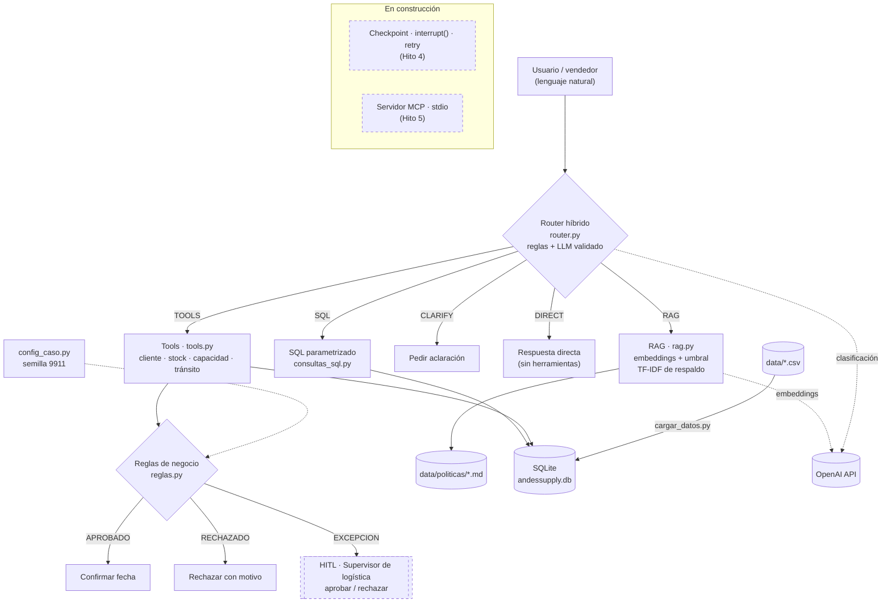

# AndesSupply · AI Operations Agent — Compromiso de entrega

Trabajo Integrador del Módulo 3 (Agentes de IA · RAG agéntico · LangGraph · MCP) del Programa AI Engineer de Data Science Research Perú.

| CASO_ID | Variante | Semilla |
|---|---|---|
| **LOG-009** | Logística | **9911** |

El agente recibe solicitudes en lenguaje natural y decide si AndesSupply puede **comprometer una fecha de entrega**. Las decisiones objetivas (plazos, capacidad, stock) las toman reglas en Python; el LLM solo interpreta el lenguaje. Cuando la fecha es incompatible o se requiere un **despacho extraordinario**, el flujo se detiene para que lo apruebe el **Supervisor de logística** (Human-in-the-Loop).

## Arquitectura



| Tipo de decisión | Responsable | Ejemplo |
|---|---|---|
| Determinista | Python (`reglas.py`, reglas del router) | 12 unidades > 9 libres → excepción |
| Semántica | Router (reglas + LLM) | ¿La consulta es de política, historial o pedido? |
| Proceso | LangGraph (`workflow.py`) | ¿Qué paso sigue y qué estado se conserva? |
| Integración | MCP *(Hito 5)* | Exponer stock y capacidad a otras aplicaciones |

## Parámetros del caso (semilla 9911)

| Parámetro | Valor |
|---|---|
| Capacidad diaria de despacho | 21 unidades |
| Ventana de entrega estándar | 5 días hábiles |
| Costo de despacho extraordinario | 300 USD |
| "Hoy" del escenario | lunes 2026-10-12 |

## Requisitos

- Python 3.12 y [uv](https://docs.astral.sh/uv/)
- Una API key de OpenAI (embeddings y router)

## Instalación

Todos los comandos se ejecutan desde la carpeta del proyecto:

```bash
cd romero_cesar_modulo3
```

```bash
uv sync
```

Copia la plantilla de variables de entorno y coloca tu clave en `.env` (nunca se sube a git):

```bash
copy .env.example .env
```

En Linux o macOS: `cp .env.example .env`.

## Uso

```bash
uv run config_caso.py          # muestra CASO_ID, semilla y parámetros
uv run cargar_datos.py         # reconstruye SQLite desde los CSV
uv run consultas_sql.py        # consultas SQL sobre el historial
uv run tools.py                # Tools de estado actual
uv run reglas.py               # reglas de negocio
uv run rag.py                  # RAG sobre las políticas (usa la API)
uv run evaluar_router.py       # evaluación del router: 14 casos (usa la API)
uv run workflow.py             # workflow LangGraph de punta a punta (usa la API)
uv run pytest -v               # 26 pruebas automáticas (sin costo: la API se simula)
```

## Estructura

Todo el proyecto vive en la carpeta `romero_cesar_modulo3/`, que es la raíz del repositorio:

```text
romero_cesar_modulo3/
├── README.md
├── pyproject.toml            # dependencias (uv)
├── uv.lock                   # versiones exactas (uv sync)
├── .env.example              # plantilla de variables de entorno (.env no se sube)
├── config_caso.py            # CASO_ID, semilla y parámetros
├── cargar_datos.py           # CSV → SQLite
├── consultas_sql.py          # SQL parametrizado (historial)
├── tools.py                  # Tools semánticas (estado actual)
├── reglas.py                 # reglas de negocio
├── rag.py                    # RAG sobre las políticas
├── router.py                 # router híbrido
├── evaluar_router.py         # casos de evaluación del router
├── workflow.py               # workflow con estado (LangGraph)
├── conftest.py               # preparación de las pruebas
├── data/
│   ├── *.csv                 # clientes, ciudades, productos, inventario, ventas, despachos
│   └── politicas/            # política de despacho y de despacho extraordinario
├── docs/
│   ├── clasificacion_solicitudes.md
│   └── diagrama_workflow.md  # diagrama generado por LangGraph
├── tests/                    # pruebas pytest
├── HITOS.md
├── EVIDENCIAS.md
├── DECISIONES.md
└── USO_IA.md
```

Archivos generados que no se versionan: `.env`, `data/andessupply.db`, `data/cache_embeddings.json`.

## Avance

| Hito | Estado |
|---|---|
| 1 · Separar responsabilidades | ✅ |
| 2 · Router + RAG + SQL + Tools | ✅ |
| 3 · Workflow con estado (LangGraph) | ✅ |
| 4 · Retry, checkpoint y HITL | 🟡 siguiente |
| 5 · MCP | ⚪ |
| 6 · Integración y reflexión | ⚪ |

Diagrama del grafo en [docs/diagrama_workflow.md](docs/diagrama_workflow.md). Detalle en [HITOS.md](HITOS.md), decisiones en [DECISIONES.md](DECISIONES.md) y evidencias en [EVIDENCIAS.md](EVIDENCIAS.md).
