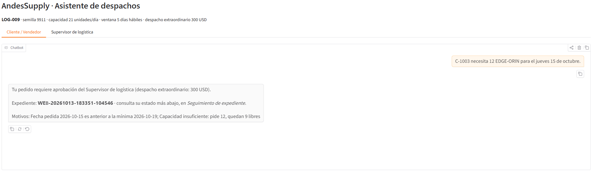
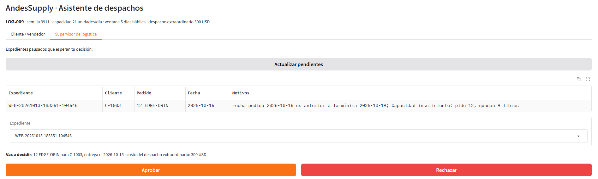
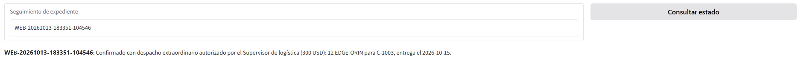
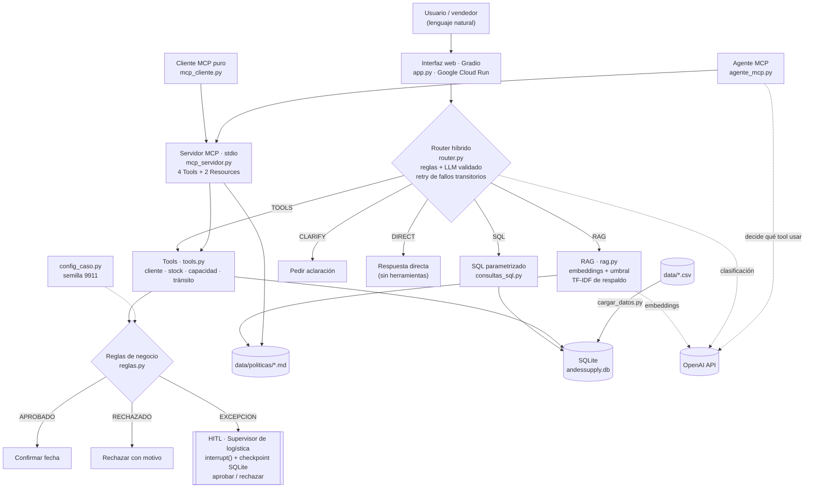

# AndesSupply · AI Operations Agent — Compromiso de entrega

Trabajo Integrador del Módulo 3 (Agentes de IA · RAG agéntico · LangGraph · MCP) del Programa AI Engineer de Data Science Research Perú.

| CASO_ID | Variante | Semilla |
|---|---|---|
| **LOG-009** | Logística | **9911** |

El agente recibe solicitudes en lenguaje natural y decide si AndesSupply puede **comprometer una fecha de entrega**. Las decisiones objetivas (plazos, capacidad, stock) las toman reglas en Python; el LLM solo interpreta el lenguaje. Cuando la fecha es incompatible o se requiere un **despacho extraordinario**, el flujo se detiene para que lo apruebe el **Supervisor de logística** (Human-in-the-Loop).

## Interfaz web (Gradio)

El agente también se usa desde el navegador. Un mismo expediente recorre las dos pestañas:

**1 · El cliente pide.** El caso base genera una excepción: el pedido queda pausado y el cliente recibe su número de expediente.



**2 · El supervisor decide.** Ve los expedientes pausados y, antes de los botones, el resumen de lo que va a aprobar o rechazar.



**3 · El cliente consulta el estado.** En *Seguimiento de expediente* ve la respuesta final tras la decisión.



La interfaz no agrega lógica de negocio: usa el mismo workflow, checkpoint (mismo `id_hilo`) y reglas que la terminal.

**Despliegue en la nube:** publicada en **Google Cloud Run** — <https://andessupply-despachos-395711457798.us-central1.run.app> (acceso con usuario y contraseña). En local: `uv run app.py`.

## Arquitectura



| Tipo de decisión | Responsable | Ejemplo |
|---|---|---|
| Determinista | Python (`reglas.py`, reglas del router) | 12 unidades > 9 libres → excepción |
| Semántica | Router (reglas + LLM) | ¿La consulta es de política, historial o pedido? |
| Proceso | LangGraph (`workflow.py`) | ¿Qué paso sigue y qué estado se conserva? |
| Integración | MCP (`mcp_servidor.py`) | Exponer stock y capacidad a otras aplicaciones |

## Parámetros del caso (semilla 9911)

| Parámetro | Valor |
|---|---|
| Capacidad diaria de despacho | 21 unidades |
| Ventana de entrega estándar | 5 días hábiles |
| Costo de despacho extraordinario | 300 USD |
| "Hoy" del escenario | lunes 2026-10-12 |

## Requisitos

- Python 3.12 y [uv](https://docs.astral.sh/uv/)
- Una API key de OpenAI (embeddings y router)

## Instalación

Todos los comandos se ejecutan desde la carpeta del proyecto:

```bash
cd romero_cesar_modulo3
```

```bash
uv sync
```

Copia la plantilla de variables de entorno y coloca tu clave en `.env` (nunca se sube a git):

```bash
copy .env.example .env
```

En Linux o macOS: `cp .env.example .env`.

## Uso

Caso end-to-end completo en un solo comando (semilla → datos → router → fuentes → reglas → HITL → MCP):

```bash
uv run demo_e2e.py aprobar      # o rechazar: decisión del supervisor (usa la API, ~0,0005 USD)
```

Componentes por separado:

```bash
uv run config_caso.py          # muestra CASO_ID, semilla y parámetros
uv run cargar_datos.py         # reconstruye SQLite desde los CSV (ejecutar tras editar un CSV)
uv run consultas_sql.py        # consultas SQL sobre el historial
uv run tools.py                # Tools de estado actual
uv run reglas.py               # reglas de negocio
uv run rag.py                  # RAG sobre las políticas (usa la API)
uv run evaluar_router.py       # evaluación del router: 14 casos (usa la API)
uv run workflow.py iniciar LOG009-0001 "C-1003 necesita 12 EDGE-ORIN para el jueves 15 de octubre."
uv run workflow.py estado LOG009-0001             # State guardado en el checkpoint
uv run workflow.py reanudar LOG009-0001 aprobar   # o rechazar (decisión del supervisor)
uv run workflow.py iniciar LOG009-0003 "..." --fallos 2   # simula 2 cortes de red: retry y continúa
uv run mcp_cliente.py          # cliente MCP puro: list_tools + call_tool (sin LLM, sin costo)
uv run agente_mcp.py           # agente que consume el servidor MCP (usa la API)
uv run pytest -v               # 43 pruebas automáticas (sin costo: la API se simula)
```

## Interfaz web y despliegue

```bash
uv run app.py                  # interfaz Gradio local: pestaña Cliente y pestaña Supervisor
```

Despliegue en **Google Cloud Run** (proyecto `bq-chat-demo`, región `us-central1`): Cloud Build construye la imagen desde el `Dockerfile` (`.gcloudignore` evita subir `.env`), los secretos `OPENAI_API_KEY`, `APP_USUARIO` y `APP_CLAVE` viven en Secret Manager y el servicio corre con la cuenta `andessupply-run`, que solo puede leer esos tres secretos. En la nube la app se sirve con uvicorn y exige contraseña.

```bash
gcloud run deploy andessupply-despachos --source . --region us-central1 --service-account andessupply-run@bq-chat-demo.iam.gserviceaccount.com --set-secrets "OPENAI_API_KEY=OPENAI_API_KEY:latest,APP_USUARIO=APP_USUARIO:latest,APP_CLAVE=APP_CLAVE:latest" --allow-unauthenticated --max-instances 1 --memory 1Gi --session-affinity
```

## Estructura

Todo el proyecto vive en la carpeta `romero_cesar_modulo3/`, que es la raíz del repositorio:

```text
romero_cesar_modulo3/
├── README.md
├── pyproject.toml            # dependencias (uv)
├── uv.lock                   # versiones exactas (uv sync)
├── .env.example              # plantilla de variables de entorno (.env no se sube)
├── config_caso.py            # CASO_ID, semilla y parámetros
├── cargar_datos.py           # CSV → SQLite
├── consultas_sql.py          # SQL parametrizado (historial)
├── tools.py                  # Tools semánticas (estado actual)
├── reglas.py                 # reglas de negocio
├── rag.py                    # RAG sobre las políticas
├── router.py                 # router híbrido
├── evaluar_router.py         # casos de evaluación del router
├── workflow.py               # workflow con estado (LangGraph)
├── mcp_servidor.py           # servidor MCP (stdio)
├── mcp_cliente.py            # cliente MCP puro (sin LLM)
├── agente_mcp.py             # agente que consume el servidor MCP
├── demo_e2e.py               # caso end-to-end reproducible
├── app.py                    # interfaz web (Gradio)
├── requirements.txt          # dependencias del contenedor
├── Dockerfile                # imagen para Google Cloud Run
├── despliegue/               # ficha para Hugging Face Spaces (alternativa)
├── conftest.py               # preparación de las pruebas
├── data/
│   ├── *.csv                 # clientes, ciudades, productos, inventario, ventas, despachos
│   └── politicas/            # política de despacho y de despacho extraordinario
├── docs/
│   ├── clasificacion_solicitudes.md
│   ├── diagrama_workflow.md  # diagrama generado por LangGraph
│   ├── img/                  # capturas de la interfaz
│   ├── diagrama_mcp.md       # antes/después de MCP
│   └── LIMITACIONES.md       # limitaciones y riesgos
├── tests/                    # pruebas pytest
├── HITOS.md
├── EVIDENCIAS.md
├── DECISIONES.md
└── USO_IA.md
```

Archivos generados que no se versionan: `.env`, `data/andessupply.db`, `data/checkpoints.db`, `data/cache_embeddings.json`.

## Avance

| Hito | Estado |
|---|---|
| 1 · Separar responsabilidades | ✅ |
| 2 · Router + RAG + SQL + Tools | ✅ |
| 3 · Workflow con estado (LangGraph) | ✅ |
| 4 · Retry, checkpoint y HITL | ✅ |
| 5 · MCP | ✅ |
| 6 · Integración y reflexión | 🟡 siguiente |

Diagrama del grafo en [docs/diagrama_workflow.md](docs/diagrama_workflow.md); MCP antes/después en [docs/diagrama_mcp.md](docs/diagrama_mcp.md); limitaciones y riesgos en [docs/LIMITACIONES.md](docs/LIMITACIONES.md). Detalle en [HITOS.md](HITOS.md), decisiones en [DECISIONES.md](DECISIONES.md) y evidencias en [EVIDENCIAS.md](EVIDENCIAS.md).
