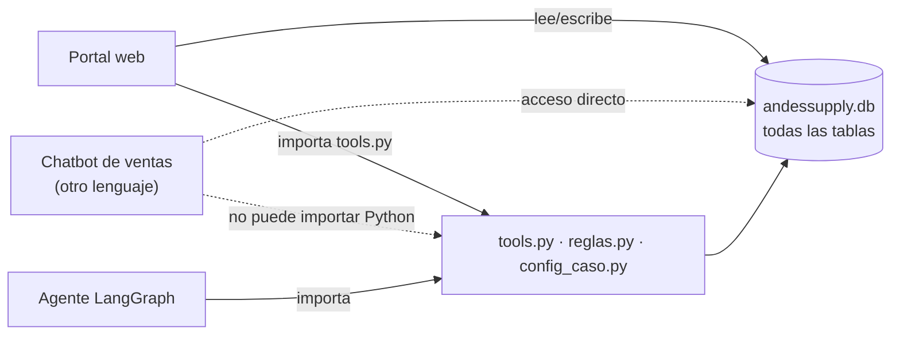
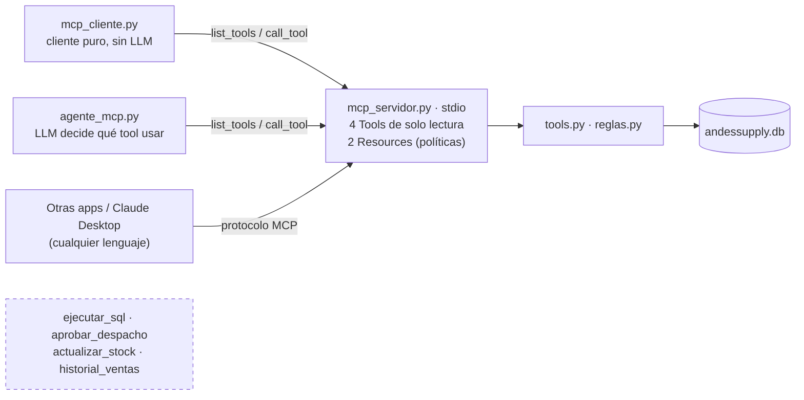

# MCP: antes y después

## Antes de MCP (acoplado)

Cada aplicación que quiere consultar stock o capacidad debe importar el código Python del proyecto y acceder directamente a la base de datos.

Problemas: dependencia del lenguaje (Python), cada cambio interno rompe a los consumidores, la lógica se copia y diverge, y todos acceden a toda la base (incluso para escribir).

## Con MCP (desacoplado, mínimo privilegio)

Los consumidores solo ven el menú publicado (`consultar_stock`, `consultar_capacidad`, `consultar_transito`, `consultar_fecha_despacho`, `politica://despacho`, `politica://despacho-extraordinario`). Lo que no se publica, no existe para ellos.
